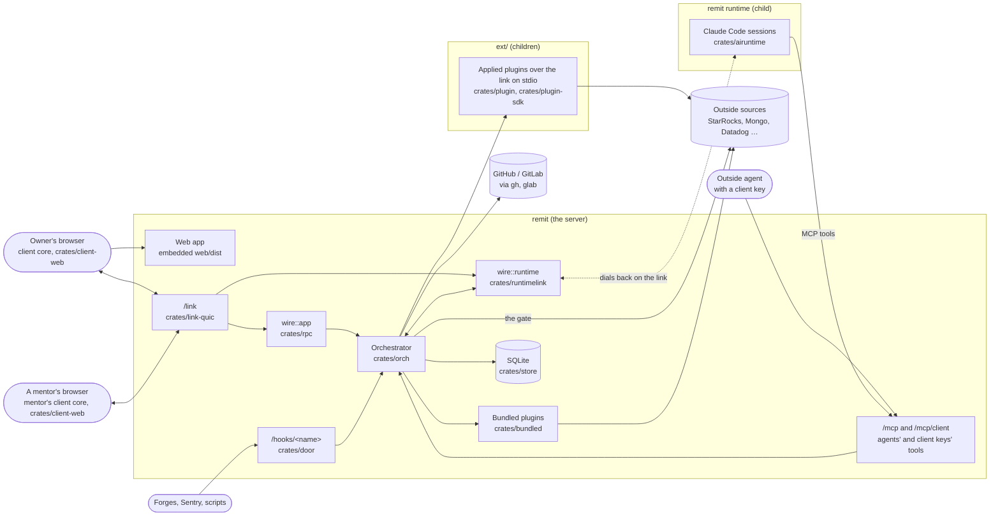
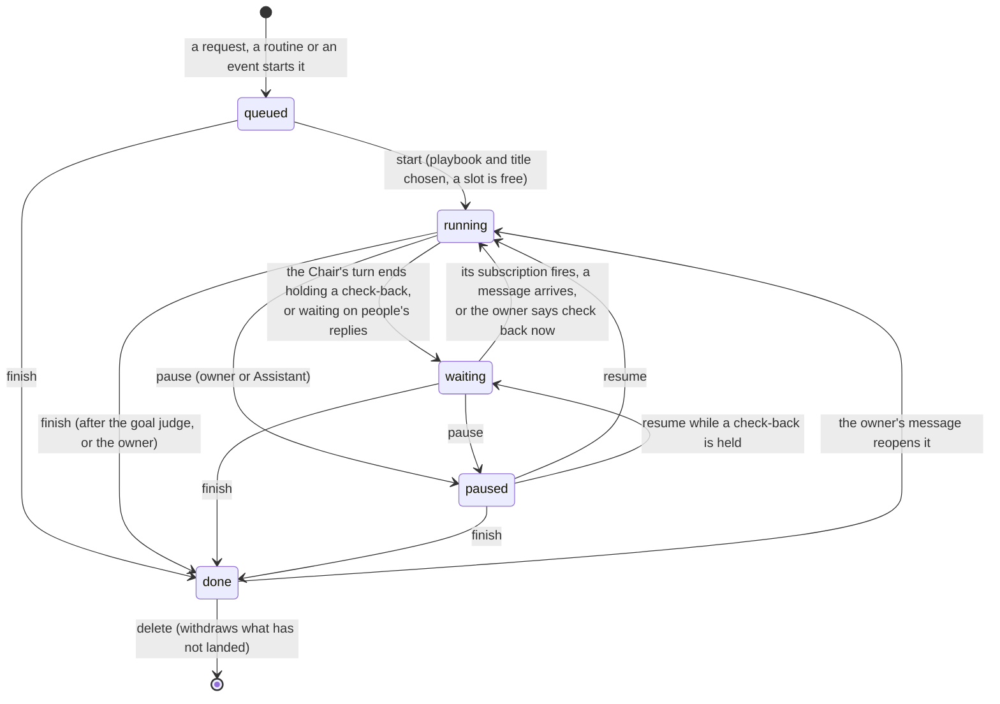
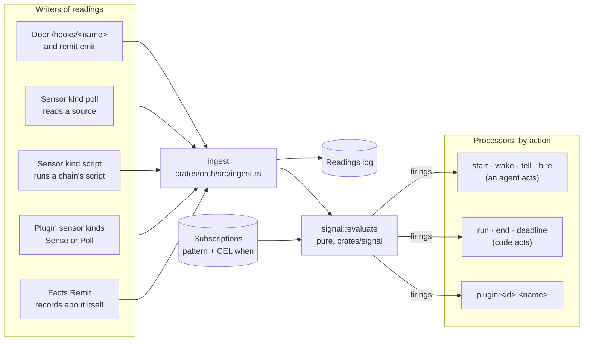
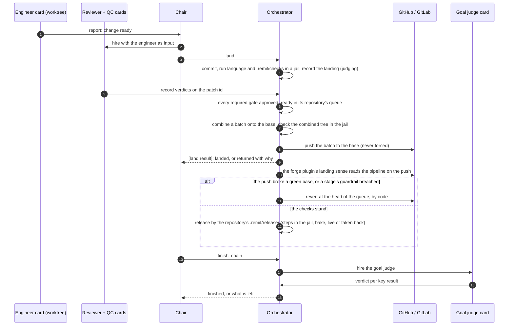
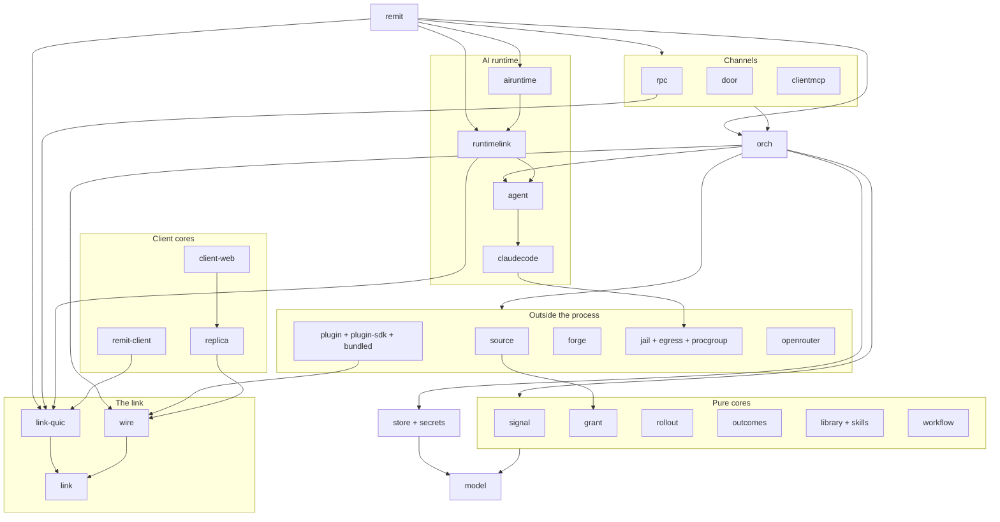

# Remit — architecture in diagrams

Five pictures of the system as it is, each drawn from the code it names. `docs/design.md` is the text they illustrate and wins
where the two differ; why each part is built this way is in `docs/adr`. The code still reads `remit` (see `docs/design.md`).

## 1. One binary, two processes

The server is one Rust binary (`crates/remit`) that serves HTTP on TCP and the link (WebTransport, `/link`) on UDP at the
same `-addr`. Every peer on the link is one session, handed by the contract its hello asks for to the channel that serves
it. The binary starts itself again as the AI runtime, which holds every Claude Code session (ADR-0058). The bundled plugins
run in-process; a plugin the owner applies runs as a child process speaking the link on its stdio (ADR-0034, ADR-0072).
Everything it keeps is one SQLite file.

| Box | Where |
|---|---|
| routes `/healthz`, `/link.json`, `/mcp`, `/mcp/client`, `/hooks/<name>`, the web app | `router`, `crates/remit/src/serve.rs:239-246` |
| the link at `/link`, each session to `rpc` or `runtimelink` by its hello | `crates/link-quic/src/lib.rs:21`, `crates/remit/src/channels.rs` |
| the runtime is the server's child, keyed per start | `crates/remit/src/runtime.rs`, ADR-0058 |
| subcommands `runtime`, `emit`, `export` | `crates/remit/src/main.rs:36-54` |
| bundled plugins `amplitude`, `forge`, `github`, `gitlab`, `googleanalytics`, `intercom`, `script` | `plugins`, `crates/bundled/src/lib.rs:27-37` |
| an applied plugin as a child process | `RemotePlugin`, `crates/plugin` |

## 2. A chain's life

A chain's status is one of five (`ChainStatus`, `crates/model/src/model.rs:13-21`), changed only by the pure step in
`crates/orch/src/step.rs`. Being archived is a separate mark on a done chain (`archived_at`), not a status.

| Edge | Where |
|---|---|
| start | `ChainCmd::Start`, `crates/orch/src/step.rs:551` |
| pause, resume | `ChainCmd::Pause`, `ChainCmd::Resume`, `pause_to`, `resume_to`, `crates/orch/src/step.rs:579-604`, `:1192-1243` |
| wait at a turn's end | `turn_ended_to`, `crates/orch/src/step.rs:1007` |
| wake | `wake_to`, `end_wait`, `crates/orch/src/step.rs:1153`, `:1298` |
| finish, reopen | `ChainCmd::Finish`, `finish_to`, `reopen_to`, `crates/orch/src/step.rs:647`, `:1244-1277` |
| archive, delete only a done chain | `ChainCmd::Archive`, `ChainCmd::Delete`, `crates/orch/src/step.rs:675-720` |

## 3. Signals: every sense writes readings, subscriptions act

Whatever Remit learns, from outside or about itself, is a reading of a signal, stored in one log. Each reading is judged at once
against the subscriptions whose pattern matches its key; a subscription that fires hands its firing to the processor its action
names (ADR-0047, ADR-0049).

| Box | Where |
|---|---|
| built-in sensor kinds poll and script | `KIND_POLL`, `KIND_SCRIPT`, `crates/model/src/sensor.rs:17-18`; `crates/orch/src/sensor.rs` |
| a plugin's kind is sensed by its plugin | `crates/orch/src/plugin_pipeline.rs` |
| `ingest` stores a reading, the one writer of the log | `crates/orch/src/ingest.rs:62` |
| `tick_signals` judges matching subscriptions | `crates/orch/src/signals.rs:199` |
| the pure judgement | `evaluate`, `crates/signal/src/evaluate.rs:100` |
| processors by action, plugin processors | `processor_of`, `crates/orch/src/processing.rs:120` |

## 4. From an agent's change to users

No change lands unchecked: the gates its chain names (a reviewer and a QC, the QC alone for a chore, and security on a
rail) approve the exact patch id before the version leaves `judging` (`crates/shipping/src/gate.rs:1-6`). Remit lands every
approved change itself: no agent merges and there is no merge request (ADR-0114). The merge queue of each repository and
base combines a batch onto the base, checks the combined tree in the jail and pushes it, never forced; the forge's
pipeline on the pushed commit is read after, and a breach is reverted by code. What landed is released by the
repository's own `.remit/release/`, run by code with no turn (ADR-0116), and a landing makes the goal judge look again
(ADR-0039).

| Step | Where |
|---|---|
| verdicts tied to the patch id, `MAX_GATE_ROUNDS` | `crates/shipping/src/gate.rs:1-39` |
| `land`: commit, checks, the landing recorded `judging`; `approve` makes it `ready` | `crates/shipping/src/land.rs:225`, `:575` |
| repository checks in a jail | `crates/shipping/src/repochecks.rs`, ADR-0025 |
| the queue: batch (`MAX_BATCH`), combine, check, push through the `Lander` port | `crates/shipping/src/landing.rs:15`, `:42`, `crates/shipping/src/queue.rs:82`, `crates/shipping/src/direct_push.rs:20` |
| the forge's checks on a push and the revert of a breach | `verdict_on`, `crates/shipping/src/landing.rs:98`; `sync_landings`, `crates/shipping/src/landing_checks.rs:90`, every `LANDING_SYNC_EVERY` (`crates/pipeline/src/automation.rs:71`); `crates/shipping/src/revert.rs:31` |
| stages of a canary | `crates/shipping/src/stage.rs`, `crates/rollout` |
| competing attempts and `pick_attempt` | `crates/shipping/src/round.rs:1-6`, `:369`, ADR-0115 |
| the release: the procedure's pure core, its runner, the install on this server | `crates/shipping/src/release.rs`, `sync_releases` and `revert_release` in `crates/shipping/src/release_run.rs:206`, `:821`, `crates/shipping/src/install.rs:91` |
| the goal check, and its recheck on `fact:chain.landed` | `crates/shipping/src/goal.rs`, `crates/shipping/src/recheck.rs`, `sub_hire_goal_recheck` (`crates/pipeline/src/automation.rs:148`) |

## 5. Crates

Which crate depends on which inside the workspace, by group, with the edges that show its layers (`cargo metadata`; dev
dependencies and the build tools `tsgen` and `claudehooks` left out). `orch` is the application layer; the
channels sit above it, and the pure cores (`signal`, `grant`, `rollout`, `outcomes`, `library`) depend on nothing but
`model` and `skills`. The client cores (`replica`, `client-web`, `remit-client`) reach the server only through `link` and
`wire`.

| Edge | Where |
|---|---|
| every dependency above | `cargo metadata --format-version 1 --no-deps` (each package's `dependencies`) |
